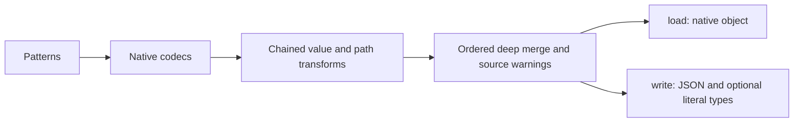

# @teyfix/directory-loader

Load structured files, use their relative paths as namespaces, and merge them into one object. Requires Bun 1.4.3 or newer. The library uses native Bun codecs and globbing; `deepmerge-ts` owns merging and Bunli owns the CLI.

Install directly from Git; no npm publication or dependency build step is needed:

```json
{ "dependencies": { "@teyfix/directory-loader": "git+https://github.com/teyfix/directory-loader.git" } }
```

```ts
import directoryLoader from '@teyfix/directory-loader';

await directoryLoader('messages').files('[lang].yaml', '[lang]/**/*.yaml').types().split().write('generated');
```

`messages/en/home.yaml` contributes its parsed contents at `en.home`. `messages/en/home/meta.yaml` contributes at `en.home.meta`. Broader files are loaded before deeper files, then in lexical path order. A deeper file can replace `meta.title` while retaining `meta.description` from the broader file. Changed existing values produce a warning naming the object path and both files. Arrays replace earlier arrays. File parsing can run concurrently; merging follows the deterministic file order.

The example writes `generated/en.json`, `generated/en.d.json.ts`, and corresponding files for other top-level keys. Without `.split()`, `.write('messages.json')` exports the entire object. `.load()` returns it without writing anything. Unchanged output is not rewritten. A hidden output manifest tracks generated files so subsequent runs remove obsolete outputs while preserving unrelated files. Use a dedicated output directory for each split pipeline.



## Chained API

|Method|Behavior|
|-|-|
|`dir(...segments)`|Set the input root; constructor arguments do the same.|
|`files(...patterns)`|Select files relative to that root; default `**/*`. Overlapping matches are deduplicated.|
|`exclude(...patterns)`|Exclude relative paths. Writes automatically exclude their own outputs.|
|`add(codec)`|Register `{ext: ['ext'], parser: {parse}}`.|
|`add(extensions, parser)`|Register a parser function or an object exposing `parse`; replaces existing registrations.|
|`remove(extension)`|Remove the selected codec and its registered aliases.|
|`clear()`|Remove all codecs.|
|`map((value, source) => value)`|Transform each parsed value; async functions are supported. Runs in registration order.|
|`path(source => segments)`|Change the mount path; an empty path merges an object at the root.|
|`onOverride(event => ...)`|Handle `{path, previous, source}` instead of the default warning.|
|`openFiles(limit)`|Limit concurrent file parsing; default 32.|
|`maxFiles(limit)`|Limit the number of discovered files loaded; default unlimited.|
|`types()`|Emit literal declarations alongside JSON, preserving message argument information.|
|`split()`|Emit one JSON per top-level key rather than one aggregate JSON.|

`source` contains the relative `file` and extension-free `path` segments. Codec parsing ends at native values; assembly does not interpret message strings. Defaults cover JSON/ARB, YAML, JSON5, JSONC, TOML, JSONL/NDJSON, and XML. Extension matching is case-insensitive. Unsupported extensions are skipped.

```ts
const data = await directoryLoader('content')
  .clear()
  .add({ ext: ['yml', 'yaml'], parser: Bun.YAML })
  .add('json', JSON)
  .add('txt', (text) => text.trim())
  .load();
```

For feature-local sources, map placement independently of the source format:

```ts
const data = await directoryLoader('src/feat')
  .files('**/messages.[lang].yaml')
  .path(({ path }) => {
    const locale = path.at(-1)!.slice('messages.'.length);
    return [locale, ...path.slice(0, -1)];
  })
  .load();
// auth/messages.en.yaml -> en.auth
```

`[lang]` is a wildcard alias, not locale validation or a captured variable. Standard glob patterns work too. This syntax reserves bracketed names; use `?`, `*` or brace alternatives instead of alphabetic bracket character classes. Keys and path casing are preserved. The loader imposes no locale list, i18n schema, plural rules, or fallback policy. See the [i18n compatibility audit](docs/i18n-compatibility.md) before connecting a runtime.

## CLI and watch

```sh
bun --bun directory-loader load '[lang].yaml' '[lang]/**/*.yaml' \
  --root messages --output generated --split --types

bun --bun directory-loader load '**/messages.[lang].yaml' \
  --root src/feat --output feature-messages.json --watch
```

The CLI provides the default path layout. Use the library chain in a script when you need custom path or value transforms. Bunli provides `load --help`, validation, and diagnostics. Without `--output`, the result is written to stdout.

`--watch` requires `watchexec` on PATH. It derives watch roots and filters from the supplied patterns, runs the same CLI without watch, and queues full reruns. It does not implement an internal watcher or incremental compiler. Generated outputs are ignored by the watcher. Build, test and typecheck commands should invoke compilation directly rather than depend on a running watcher.

For JSON imports:

```ts
export type MessagesEN = typeof import('./generated/en.json').default;
```

Without `.types()`, TypeScript knows the JSON shape but widens strings. Literal declarations retain strings such as `Hello {name}` for consumers that infer message arguments. Enable `compilerOptions.allowArbitraryExtensions: true` in the consuming TypeScript project to use the generated `.d.json.ts` declarations.

## Development

```sh
mkdir -p .cache/bun

docker compose build bun
docker compose run --rm bun install --frozen-lockfile
docker compose run --rm bun run format
docker compose run --rm bun run verify
```

Bun owns tests, typechecking, and builds. Biome owns TypeScript; Prettier with `.prettierrc.yaml` owns the other supported formats. Normal installation installs Lefthook; staged hooks delegate formatting to the same Compose service. Source filenames use `kebab-case.kind.ts`. Git consumers import the TypeScript source directly; the optional build emits Bun-targeted bundles into ignored `dist/`. CI checks changes and never publishes to npm.
