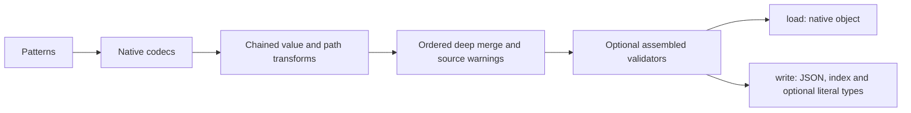

# @teyfix/directory-loader

Load structured files, use their relative paths as namespaces, and merge them into one object. Requires Bun 1.4.3 or newer. The library uses native Bun codecs and globbing; `deepmerge-ts` owns merging and Bunli owns the CLI.

Install directly from Git; no npm publication or dependency build step is needed:

```json
{ "dependencies": { "@teyfix/directory-loader": "git+https://github.com/teyfix/directory-loader.git" } }
```

For repeated multi-output generation, use an optional [`.directory-loader.yaml`](docs/pipeline-config.md): `bun --bun directory-loader run` discovers it automatically, and `run --watch` watches every target through one process. The config translates into the same builders shown below.

```ts
import directoryLoader from '@teyfix/directory-loader';

await directoryLoader('messages').files('[lang].yaml', '[lang]/**/*.yaml').types().split().write('generated');
```

`messages/en/home.yaml` contributes its parsed contents at `en.home`. `messages/en/home/meta.yaml` contributes at `en.home.meta`. Broader files are loaded before deeper files, then in lexical path order. A deeper file can replace `meta.title` while retaining `meta.description` from the broader file. Changed existing values produce a warning naming the object path and both files. Arrays replace earlier arrays. File parsing can run concurrently; merging follows the deterministic file order.

The example writes `generated/en.json`, `generated/en.d.json.ts`, corresponding files for other top-level keys, and a generated `index.ts` exporting `catalogues` and `Messages`. Without `.split()`, `.write('messages.json')` exports the entire object. `.load()` returns it without writing anything. Unchanged output is not rewritten. A hidden output manifest tracks generated files so subsequent runs remove obsolete outputs while preserving unrelated files. Use a dedicated output directory for each split pipeline.



## Chained API

|Method|Behavior|
|-|-|
|`dir(...segments)`|Set the input root; constructor arguments do the same.|
|`files(...patterns)`|Select files relative to that root; default `**/*`. Overlapping matches are deduplicated.|
|`exclude(...patterns)`|Exclude relative paths. Writes automatically exclude their own outputs.|
|`add(codec)`|Register `{ext: ['ext'], parser: {parse}}`.|
|`add(extensions, parser)`|Register a parser function or an object exposing `parse`; replaces existing registrations.|
|`remove(extension)`|Remove the selected codec and its registered aliases.|
|`clear()`|Remove all codecs.|
|`map((value, source) => value)`|Transform each parsed value; async functions are supported. Runs in registration order.|
|`path(...transforms)`|Compose mount-path transforms in registration order; an empty path merges an object at the root.|
|`validate(validator)`|Validate the assembled object before returning or writing; async validators are awaited in registration order.|
|`onOverride(event => ...)`|Handle `{path, previous, source}` instead of the default warning.|
|`openFiles(limit)`|Limit concurrent file parsing; default 32.|
|`maxFiles(limit)`|Limit the number of discovered files loaded; default unlimited.|
|`types()`|Emit literal declarations alongside JSON, preserving message argument information.|
|`split()`|Emit one JSON per top-level key rather than one aggregate JSON.|
|`arb()`|Emit validated flat ARB files per locale into a dedicated directory; see the [ARB contract](docs/arb-output.md).|
|`prepare(output)`|Stage validated data and serialized outputs without publishing; returns `{data, files, publish}`.|

`source` contains the relative `file` and extension-free `path` segments. Codec parsing ends at native values; assembly does not interpret message strings. Defaults cover JSON/ARB, YAML, JSON5, JSONC, TOML, JSONL/NDJSON, and XML. Extension matching is case-insensitive. Unsupported extensions are skipped.

`writeAll({name: {loader, output}, ...})` prepares separate builders together before publishing any target, and returns a watchable execution. `configure` from the optional `@teyfix/directory-loader/config` entrypoint interprets validated config objects through that coordinator. See [configuration and programmatic multi-output pipelines](docs/pipeline-config.md) for ownership, watch and failure semantics.

```ts
const data = await directoryLoader('content')
  .clear()
  .add({ ext: ['yml', 'yaml'], parser: Bun.YAML })
  .add('json', JSON)
  .add('txt', (text) => text.trim())
  .load();
```

For feature-local sources, map placement independently of the source format:

```ts
const data = await directoryLoader('src/feat')
  .files('**/messages.[lang].yaml')
  .path(({ path }) => {
    const locale = path.at(-1)!.slice('messages.'.length);
    return [locale, ...path.slice(0, -1)];
  })
  .load();
// auth/messages.en.yaml -> en.auth
```

`[lang]` is a wildcard alias, not locale validation or a captured variable. Standard glob patterns work too. This syntax reserves bracketed names; use `?`, `*` or brace alternatives instead of alphabetic bracket character classes. Keys and path casing are preserved. The core loader imposes no locale list, i18n schema, plural rules, or fallback policy. Opt into message checks with the separate ICU validator. See the [i18n compatibility audit](docs/i18n-compatibility.md) before connecting a runtime.

## Path helpers and pipeline files

Path transforms use the same callback contract as `.path()`, and compose across repeated calls. `stripSegments(...names)` removes matching directory names. `recaseSegments(casing, skip)` uses `change-case`, with `skip` preserving leading segments such as locale identifiers. `redirectPaths(mapping)` redirects slash-delimited path suffixes, preserving any prefix; the longest matching suffix wins.

```ts
// messages.compile.ts
import directoryLoader, { redirectPaths, stripSegments, recaseSegments } from '@teyfix/directory-loader';
import { icu } from '@teyfix/directory-loader/icu';

export default directoryLoader('messages')
  .files('[lang].yaml', '[lang]/**/*.yaml')
  .path(redirectPaths({ 'studio/output/components/workbench': 'studio/output' }))
  .path(stripSegments('components'), recaseSegments('camel', 1))
  .validate(icu({ referenceLocale: 'en', locales: ['en', 'tr'] }))
  .types()
  .split()
  .write('src/i18n/generated');
```

All relative paths in a pipeline resolve from the pipeline file's directory. Export the `.write()` or `.load()` execution directly, as above; it is an ordinary awaitable Promise carrying its loader's watch inputs. A synchronous default function returning that execution is also supported. Do not await it before exporting or wrap it in an async function when using watch, because that discards the watch metadata.

```sh
bun --bun directory-loader run messages.compile.ts
bun --bun directory-loader run messages.compile.ts --watch
```

The generated index removes handwritten catalogue imports:

```ts
import { catalogues, type Messages } from './i18n/generated';
```

The index imports all emitted catalogues eagerly. For lazy locale loading, import individual JSON files instead. `Messages` is the union of catalogue value types; with `.types()` it preserves each locale's message literals.

`icu({referenceLocale, locales?})` delegates ICU parsing to FormatJS and validates string-only message trees, equal message keys, typed argument signatures, and rich-tag names. Locale-specific plural categories may differ. `locales` requires those locales to exist; without it, all discovered locales are checked against the required reference locale. It does not interpret ARB metadata, i18next-native interpolation, custom format types, or fallback policy. Use your own `.validate(fn)` for other domains. A thrown error or rejected validator prevents output replacement.

## CLI and watch

```sh
bun --bun directory-loader load '[lang].yaml' '[lang]/**/*.yaml' \
  --root messages --output generated --split --types

bun --bun directory-loader load '**/messages.[lang].yaml' \
  --root src/feat --output feature-messages.json --watch
```

The `load` command provides the default path layout. The `run` command executes the exported chain when you need custom transforms or validators. Bunli provides `load --help`, validation, and diagnostics. Without `--output`, the result is written to stdout.

`--watch` requires `watchexec` on PATH. It derives watch roots and filters from the supplied patterns, runs the same CLI without watch, and queues full reruns. It does not implement an internal watcher or incremental compiler. Generated outputs are ignored by the watcher. Pipeline watch also watches the pipeline file itself. It executes once to discover the chain and watchexec then performs its initial run, so startup can compile twice without rewriting unchanged output. Watch roots are discovered once; restart watch after changing the pipeline to add new input roots or patterns. Build, test and typecheck commands should invoke compilation directly rather than depend on a running watcher.

For JSON imports:

```ts
export type MessagesEN = typeof import('./generated/en.json').default;
```

Without `.types()`, TypeScript knows the JSON shape but widens strings. Literal declarations retain strings such as `Hello {name}` for consumers that infer message arguments. Enable `compilerOptions.allowArbitraryExtensions: true` in the consuming TypeScript project to use the generated `.d.json.ts` declarations.

## Development

```sh
mkdir -p .cache/bun

docker compose build bun
docker compose run --rm bun install --frozen-lockfile
docker compose run --rm bun run format
docker compose run --rm bun run verify
```

Bun owns tests, typechecking, and builds. The tooling image includes watchexec 2.8.0; watch tests are required and fail when it is missing. CI uses the same Compose build and verification commands. Biome owns TypeScript; Prettier with `.prettierrc.yaml` owns the other supported formats. Normal installation installs Lefthook; staged hooks delegate formatting to the same Compose service. Source filenames use `kebab-case.kind.ts`. Git consumers import the TypeScript source directly; the optional build emits Bun-targeted bundles into ignored `dist/`. CI checks changes and never publishes to npm.
