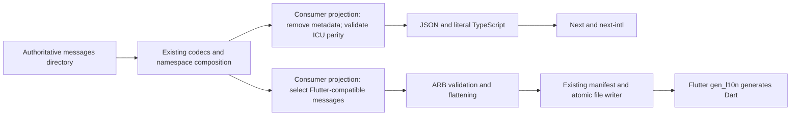

# Optional ARB output

Use `.arb()` to derive Flutter resources from locale-keyed message trees through the existing chain:

```ts
await directoryLoader('messages').files('[lang].yaml', '[lang]/**/*.yaml').arb().write('generated/arb');
```

This emits `en.arb`, `tr.arb`, etc. into a dedicated directory. It implies directory output; `.split()` is redundant and `.types()` is rejected. The returned value remains the assembled input. Existing JSON output and generic codecs are unchanged. Use the CLI's `run` command for an ARB pipeline; there is no additional `load` flag. Flutter `gen_l10n` owns Dart generation. Consumer projects own physical path mapping, required locale policy and projections for platform-specific messages.



## Accepted input

The assembled root must contain locale objects. Locale keys use `en`, `tr`, `en_US` or `zh_Hant_TW` spelling: two or three lowercase language letters, optional title-case four-letter script, optional uppercase two-letter or three-digit region. `@@locale` is optional at each locale root; when supplied it must match the key. Output always includes it. Other `@@` metadata and nested `@@locale` are rejected.

Namespaces contain objects and string message leaves. Flattening joins namespace and message segments with `_`: `en.home.greeting` becomes `home_greeting`. Flattened identifiers and placeholder names start with a lowercase ASCII letter, followed by ASCII letters, digits or underscores. Dart keywords and generated/inherited localization member names are reserved. Flattened collisions and repeated assembled message paths across source contributions are rejected, even when the strings are equal. Generic JSON retains its existing ordered override behavior. Duplicate keys already discarded by a codec cannot be recovered by the exporter.

Message metadata is a sibling `@message` object. It may contain a string `description` and an object `placeholders`. Each placeholder requires `type: String | int | double | num`, and may contain a string `example`. Unknown fields, nulls, arrays, orphan metadata, unused placeholders and arguments without metadata are rejected. Metadata is emitted unchanged under the flattened `@message` key. All exported locales must have equal flattened message keys and placeholder names/types; descriptions, examples and plural categories may vary. Reference comparison uses the first locale in the assembled object. Applications requiring specific locales should also configure their own validator.

```yaml
# messages/en/home.yaml
greeting: 'Hello {name}'
'@greeting':
  description: Greet the signed-in person
  placeholders:
    name:
      type: String
      example: Ada
items: '{count, plural, one {One item} other {Many items}}'
'@items':
  placeholders:
    count:
      type: int
```

Supported message syntax is ICU interpolation, cardinal plurals with numeric placeholders, and select with String placeholders, including nested branches. FormatJS owns parsing. Selectors are restricted to ASCII identifiers, integers and nonnegative integer exact plural matches. No message rewriting occurs. Rich tags, plural `#`, offsets, ordinals, number/date/time formatters and custom format metadata are rejected. Use separate consumer projections for these dialects. In particular, Flutter treats `#` as literal text rather than ICU's formatted count. Single ASCII apostrophes also have different parser semantics: use doubled apostrophes or typographic apostrophes. Configure Flutter `use-escaping: true`; arbitrary ICU quoting is outside this contract.

## Publication and diagnostics

The exporter validates every locale and serializes the complete file set before publishing. Diagnostics include the assembled path and source-relative file where available, after consumer path transforms. Collision errors identify both contributing paths/sources. The shared writer leaves identical files untouched, replaces changed files through temporary-file rename, and removes only stale files from its validated manifest. Switching a dedicated output directory between JSON and ARB also removes the previous owned format. Unrelated files are preserved. Input/validation/serialization failures preserve previous files and the manifest. Atomicity is per file; as with existing JSON output, an I/O failure midway through publication is not a directory-wide transaction.

## Verified consumers

The authoritative [integration catalogue](../integration/messages) authors English, Turkish and German once. The [shared configuration](../integration/.directory-loader.yaml) derives nested JSON/literal declarations after removing metadata and validating ICU parity, and ARB after excluding the `web` namespace. The [config runner](pipeline-config.md) prepares both targets before publishing either. Rich text remains authored once in `web`, reaches next-intl and is deliberately excluded from Flutter. No generated outputs are hand-edited or committed.

Verified on 2026-11-10 with Bun **1.4.3**, Next **16.4.6**, next-intl **4.14.9**, React **19.3.1**, TypeScript **6.0.3**, Flutter **3.47.7** (framework `abaf9c5237`) and Dart **3.13.5**. Integration dependencies are isolated to the consumer fixtures; the exporter adds no runtime dependency. `flutter gen-l10n`, the generated Dart consumer's interpolation/plural/select test and `flutter analyze` pass. The real Next App Router server renders both locales with interpolation, plural/select and rich links; TypeScript verifies valid calls and expected errors for unknown keys, missing arguments/tags and nonnumeric plural arguments. Shared-catalogue regression tests reject missing locales and argument/rich-tag parity changes.

next-intl's literal argument inference currently produces `never` for a placeholder reused both as plural controller and plain interpolation inside its branches (for example `{count, plural, other {{count} items}}`). The text can be transported, but that spelling is not qualified for a typed shared consumer. The fixture tests interpolation and plural selection separately. Its `AppConfig.Messages` uses the generated `Messages` union so translated literals in request configuration remain assignable. These findings qualify this bounded catalogue, not arbitrary ICU, every Flutter locale or a production application/device build.

Reproduce from the repository root with Docker/Compose and a Flutter SDK at `$FLUTTER_SDK` (default `/home/dixie/.local/opt/flutter`):

```sh
mkdir -p .cache/bun .cache/flutter
docker compose build bun
docker compose run --rm bun install --frozen-lockfile
docker compose run --rm bun src/directory-loader.cli.ts run integration/.directory-loader.yaml
docker compose run --rm bun install --cwd integration/next --frozen-lockfile
docker compose run --rm bun --cwd integration/next --bun tsc --noEmit
docker compose run --rm bun --cwd integration/next verify.ts
docker compose run --rm flutter --version
docker compose run --rm flutter pub get
docker compose run --rm flutter gen-l10n
docker compose run --rm flutter test
docker compose run --rm flutter analyze
docker compose run --rm bun run verify
```

The Flutter tooling service reuses the installed SDK and stores Pub downloads under `.cache/flutter`; it starts no device. Source inspection: [Flutter gen_l10n](https://github.com/flutter/flutter/blob/abaf9c5237/packages/flutter_tools/lib/src/localizations/gen_l10n.dart), [Flutter parser](https://github.com/flutter/flutter/blob/abaf9c5237/packages/flutter_tools/lib/src/localizations/message_parser.dart), [next-intl TypeScript augmentation](https://next-intl.dev/docs/workflows/typescript).
