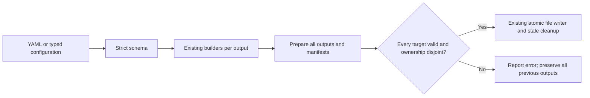

# Declarative pipeline configuration

Put `.directory-loader.yaml` in the consumer project and run `directory-loader run`. The command discovers that filename in the current directory. Pass an explicit `.yaml` or `.yml` path to use another file. Every input and output path resolves relative to the config file, independently of the invoking directory.

```yaml
# yaml-language-server: $schema=./node_modules/@teyfix/directory-loader/config.schema.json
root: messages
files: ['[lang].yaml', '[lang]/**/*.yaml']
validation:
  icu:
    referenceLocale: en
    locales: [en, tr, de]
outputs:
  web:
    format: json
    directory: src/i18n/generated
    types: true
    metadata: omit
  mobile:
    format: arb
    directory: flutter/lib/l10n
    exclude: ['**/web.yaml']
```

```sh
bun --bun directory-loader run
bun --bun directory-loader run --watch
bun --bun directory-loader run config/messages.yaml
```

The YAML interpreter calls the same `DirectoryLoader` methods as a TypeScript pipeline. It uses native Bun YAML parsing and the existing Zod dependency. There is no second merge, codec or publication implementation. Unknown fields, empty output sets, invalid operation arguments and incompatible output options fail with a config filename and validation details. The shipped `config.schema.json` provides editor completion; it is also available through the package's `./config.schema.json` export.



## Configuration fields

`root` and a nonempty named `outputs` object are required. Output names label results and errors; they have no framework semantics. The loader does not supply a locale list, default application language, fallback or route policy. ICU's `referenceLocale` selects the comparison catalogue, not an application default language.

The root and individual outputs accept these operations:

|Field|Behavior|
|-|-|
|`files`|Nonempty array of source globs. Defaults to `['**/*']`. An output replaces the shared selection when provided.|
|`exclude`|Source exclusions. Shared and output-specific arrays are combined.|
|`path`|Ordered path operations. Shared operations run before output-specific operations.|
|`metadata`|`preserve` (default) or `omit`. Omitting recursively removes object keys beginning with `@`; other values retain their native shapes. An output overrides the shared setting.|
|`validation.icu`|Existing ICU syntax/key/argument/tag validation, with required `referenceLocale` and optional nonempty `locales`. An output replaces the shared validation when provided. Metadata is stripped only from the validation view, so ARB metadata remains available to its exporter.|

`path` accepts the existing helpers, without expressions or executable YAML:

```yaml
path:
  - strip: [components]
  - redirect:
      studio/page-composition/workbench: studio/page-composition
  - recase:
      casing: camel
      skip: 1
```

`recase.casing` is `camel`, `kebab`, `pascal` or `snake`; `skip` is a nonnegative integer defaulting to zero. Redirects match path suffixes using the existing longest-match behavior. See the [chained API](../README.md#path-helpers-and-pipeline-files) for path semantics.

Each output selects exactly one of these shapes:

|Output|Options|
|-|-|
|Split JSON|`format: json`, `directory: ...`, optional `types: true`. Emits JSON per top-level key, the generated index and optional literals.|
|Aggregate JSON|`format: json`, `file: ...json`, optional `types: true`.|
|ARB|`format: arb`, `directory: ...`. The [ARB contract](arb-output.md) applies; `types` is rejected. Preserve metadata when messages have placeholders.|

Use dedicated, non-overlapping output paths. Every target automatically excludes all of the group's output locations from its sources. Preparation also checks complete file ownership, including manifests and stale owned files, before publication. Arbitrary source transforms, codecs and validators stay in TypeScript chains.

## Programmatic pipelines

The same configuration can be used from TypeScript with `configure` from `@teyfix/directory-loader/config`. Export the returned execution directly to retain CLI watch metadata:

```ts
import { configure, type PipelineConfig } from '@teyfix/directory-loader/config';

const config = { root: 'content', outputs: { data: { format: 'json', file: 'generated/content.json' } } } satisfies PipelineConfig;

export default configure(config);
```

`configure(config, base?)` validates its input and resolves paths against `base`, defaulting to the current directory. The CLI executes TypeScript pipelines from their own directory, as before. Configured operation order follows the builder's source-value mapping, path transformation, assembly and final validation boundaries.

For custom callbacks, export `writeAll` from the main package. Each target receives a separate loader and output path:

```ts
import directoryLoader, { writeAll } from '@teyfix/directory-loader';
import { stripMessageMetadata } from '@teyfix/directory-loader/icu';

export default writeAll({ web: { loader: directoryLoader('messages').map(stripMessageMetadata).types().split(), output: 'generated/web' }, mobile: { loader: directoryLoader('messages').exclude('**/web.yaml').arb(), output: 'generated/mobile' } });
```

Awaiting `configure()` or `writeAll()` returns the assembled data keyed by target name. Each target is prepared using the existing loader; all preparation work settles before errors return. Validation, serialization, manifest and output-ownership errors prevent publication of every target. Once publication starts, replacement is atomic per file, just as for `.write()`; an I/O failure is not a directory-wide or cross-output transaction. `.prepare(output)` exposes the underlying `{data, files, publish}` staging result for callers needing that lower-level boundary.

## Watch and verification

One watchexec process watches the config/pipeline file and the union of source patterns. Only exclusions common to every target are applied globally. A mobile exclusion such as `**/web.yaml` therefore cannot suppress a source needed by the web target. Output locations are excluded for every target. Full reruns preserve unchanged files and clean stale owned files.

Source validation failures and later invalid config edits report errors while the watcher remains active and can recover after correction. Initial startup requires a valid config to discover inputs. Watch roots and filters are discovered once; restart after changing source roots, patterns, exclusions or output locations. Ordinary changes to validation, metadata or type emission are picked up without restarting. Custom TypeScript pipelines retain the same rule: export the execution without awaiting it or hiding it in an async function.

The [shared config fixture](../integration/.directory-loader.yaml) exercises JSON/literal and ARB generation, with the existing real Next and Flutter consumers. Regression tests cover default discovery and relative paths, schema/artifact consistency, target-specific watch inputs, invalid config/data recovery, whole-group prepublication failure, shared source/output exclusion, path helpers, stale files and TypeScript callbacks. Generate a fresh editor schema after changing the runtime schema with `docker compose run --rm bun run schema`; tests detect a stale artifact.
